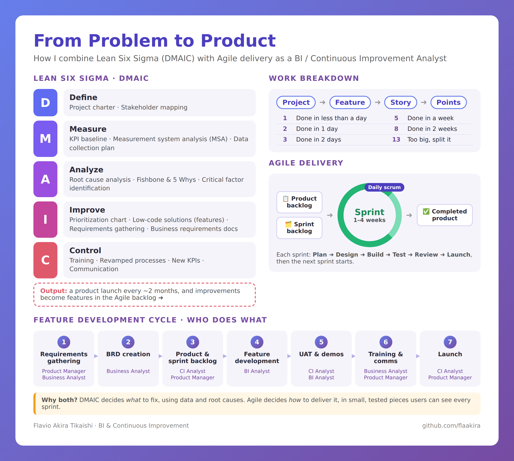

# From Problem to Product: DMAIC + Agile Delivery Framework

How I combine **Lean Six Sigma (DMAIC)** with **Agile delivery** as a BI / Continuous Improvement Analyst, plus 15 reusable templates.

- **Interactive page:** https://flaakira.github.io/dmaic-agile-framework.html
- **Templates:** [`/templates`](templates)

## Why combine them?
Continuous improvement work tends to fail in one of two ways: a great root-cause analysis that never ships, or fast delivery that solves the wrong problem.
- **DMAIC decides _what_ to fix**, using data and root causes.
- **Agile decides _how_ to deliver it**, in small, tested pieces users can see every sprint.

In **Improve**, each prioritized solution becomes a **feature** in the product backlog. **Control** wraps up each release with training, revamped processes and new KPIs. A product launch ships about **every 2 months**.

## 1. Lean Six Sigma · DMAIC
| Phase | Key question | Tools | Template |
|---|---|---|---|
| **Define** | What problem, for whom, what does success look like? | Project charter, stakeholder mapping | [Charter](templates/01-project-charter.md), [Stakeholder map](templates/02-stakeholder-map.md) |
| **Measure** | How big is it, and can we trust the data? | KPI measurement, MSA, data collection plan | [Data collection plan](templates/03-data-collection-plan.md), [MSA](templates/11-measurement-system-analysis.md) |
| **Analyze** | What is really causing it? | RCA, fishbone & 5 Whys, critical factor identification | [Root cause analysis](templates/04-root-cause-analysis.md) |
| **Improve** | What gives the most impact for the effort? | Prioritization chart, low-code solutions, requirements gathering, BRDs | [Prioritization](templates/05-prioritization-matrix.md), [Requirements gathering](templates/10-requirements-gathering-guide.md), [BRD](templates/06-business-requirements-document.md), [Low-code design](templates/12-low-code-solution-design.md) |
| **Control** | How do we make it stick? | Training, revamped processes, new KPIs, communication, product launch | [Control plan](templates/09-control-plan.md), [Training & comms](templates/14-training-and-communication-plan.md), [Release notes](templates/15-release-and-launch-notes.md) |

## 2. Work breakdown & story points
**Project → Feature → Story → Story points**

| Points | Meaning |
|---|---|
| 1 | Done in less than a day |
| 2 | Done in 1 day |
| 3 | Done in 2 days |
| 5 | Done in a week |
| 8 | Done in 2 weeks |
| 13 | Too big: split into smaller stories |

Template: [User story & estimation](templates/07-user-story-and-estimation.md)

## 3. Agile delivery
Product backlog → Sprint backlog → **Sprint (1–4 weeks, daily scrum)** → Completed product.
Each sprint: Plan → Design → Build → Test → Review → Launch.

Template: [Sprint planning, daily scrum, review & retro](templates/13-sprint-ceremonies.md)

## 4. Feature development cycle
| # | Step | Roles involved | Template |
|---|---|---|---|
| 1 | Requirements gathering | Product Manager, Business Analyst | [Requirements gathering guide](templates/10-requirements-gathering-guide.md) |
| 2 | BRD creation | Business Analyst | [BRD](templates/06-business-requirements-document.md) |
| 3 | Product & sprint backlog | CI Analyst, Product Manager | [User stories](templates/07-user-story-and-estimation.md), [Sprint ceremonies](templates/13-sprint-ceremonies.md) |
| 4 | Feature development | BI Analyst | [Low-code solution design](templates/12-low-code-solution-design.md) |
| 5 | UAT & demos | CI Analyst, BI Analyst | [UAT checklist](templates/08-uat-checklist.md) |
| 6 | Training & comms | Business Analyst, Product Manager | [Training & communication plan](templates/14-training-and-communication-plan.md) |
| 7 | Launch | CI Analyst, Product Manager | [Release & launch notes](templates/15-release-and-launch-notes.md) |

## Templates
| File | Phase |
|---|---|
| [01-project-charter.md](templates/01-project-charter.md) | Define |
| [02-stakeholder-map.md](templates/02-stakeholder-map.md) | Define |
| [03-data-collection-plan.md](templates/03-data-collection-plan.md) | Measure |
| [04-root-cause-analysis.md](templates/04-root-cause-analysis.md) | Analyze |
| [05-prioritization-matrix.md](templates/05-prioritization-matrix.md) | Improve |
| [06-business-requirements-document.md](templates/06-business-requirements-document.md) | Improve |
| [07-user-story-and-estimation.md](templates/07-user-story-and-estimation.md) | Agile |
| [08-uat-checklist.md](templates/08-uat-checklist.md) | Agile |
| [09-control-plan.md](templates/09-control-plan.md) | Control |
| [10-requirements-gathering-guide.md](templates/10-requirements-gathering-guide.md) | Improve · Step 1 |
| [11-measurement-system-analysis.md](templates/11-measurement-system-analysis.md) | Measure |
| [12-low-code-solution-design.md](templates/12-low-code-solution-design.md) | Improve · Step 4 |
| [13-sprint-ceremonies.md](templates/13-sprint-ceremonies.md) | Agile |
| [14-training-and-communication-plan.md](templates/14-training-and-communication-plan.md) | Control · Step 6 |
| [15-release-and-launch-notes.md](templates/15-release-and-launch-notes.md) | Control · Step 7 |

Feel free to copy and adapt them.

---
Author: Flavio Akira Tikaishi · Six Sigma Green Belt · [Portfolio](https://flaakira.github.io/) · [LinkedIn](https://www.linkedin.com/in/flavio-akira)
